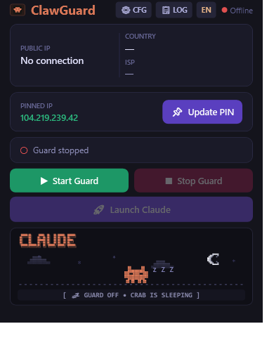
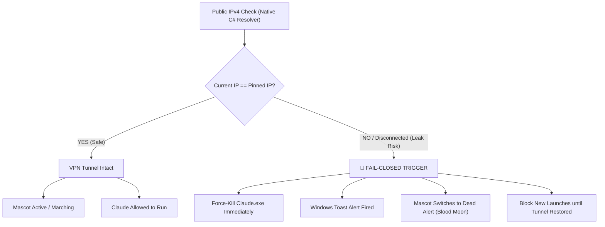

# ClawGuard 🦀🛡️

<div align="center">



**Fail-Closed VPN Kill Switch & Claude Companion for Windows**  
*Zero-Leak Security • Native Non-Blocking Network Engine • Retro Pixel Art Sentinel*

[](https://github.com/GafarovMaxim/ClawGuard/releases)
[](https://github.com/GafarovMaxim/ClawGuard)
[](LICENSE)
[](src/Program.cs)
[](https://github.com/GafarovMaxim/ClawGuard/releases)
[](#security-architecture)

[**Download Latest Release (v2.5.2)**](https://github.com/GafarovMaxim/ClawGuard/releases/latest) • [**Features**](#key-features) • [**Architecture**](#security-architecture) • [**Build from Source**](#building-from-source)

</div>

---

## 📖 Overview

**ClawGuard** is an open-source, ultra-lightweight **fail-closed VPN kill switch and companion daemon** designed specifically to protect Claude and other sensitive network workflows from sudden VPN tunnel drops and IP leaks.

Unlike standard kill switches that rely on sluggish polling or fragile routing table modifications, ClawGuard continuously monitors your public IPv4 address through a multi-endpoint native asynchronous resolver. The moment your public IP deviates from your pinned trusted IP (e.g., during a VPN reconnect, protocol stutter, or adapter reset), ClawGuard **instantly terminates protected processes** within milliseconds before unencrypted packets can escape.

The entire experience is wrapped in a bespoke retro-terminal interface inspired by Claude Code, featuring an animated pixel-art crab mascot whose behaviors dynamically reflect the real-time security state of your connection.

---

## ✨ Key Features

- 🛡️ **Fail-Closed VPN Kill Switch:** Guarantees zero leakage by aggressively closing protected applications (`Claude.exe`) upon any IP discrepancy.
- ⚡ **Asynchronous Multi-Endpoint Engine:** Pure native C# `NativeIPResolver` executes HTTP/HTTPS checks concurrently across multiple geo-redundant providers (`ipwho.is`, `ip-api.com`, `ipinfo.io`, `api.ipify.org`) with millisecond-level non-blocking timeouts.
- 🦀 **Reactive Pixel Art Sentinel:**
  - **Walking Mode (Active Protection):** Smooth 4-phase walking gait synchronized with an animated treadmill track when Claude is running securely.
  - **Awake Sentinel Mode:** Idle alert state where the crab breathes and curious glances left and right to inspect the perimeter.
  - **Sleep Mode:** Gentle night sky with moon and drifting clouds when protection is idle.
  - **Dead Mode:** Red alert state with broken track and sinister blood moon when an IP leak or VPN drop occurs.
- 🔒 **Named System Mutex:** `Global\ClawGuard_SingleInstance_Mutex` prevents accidental duplicate processes.
- 🪟 **Immersive Dark Titlebar:** Win32 DWM immersive dark mode with clean header geometry and crisp multi-resolution system tray integration.
- 🍃 **Zero CPU Waste in Tray:** Dispatcher timers and animations automatically suspend when minimized to the Windows notification tray, idling at **0% CPU** and ~85 MB RAM.
- 🌐 **Bilingual Localization:** Instant single-click language toggle between English and Russian without application restart.
- 📦 **100% Portable:** Single standalone executable requiring zero installers, runtime dependencies, or registry pollution.

---

## 🔒 Security Architecture



### Protection Guarantees
1. **Never Fails Open:** If connectivity drops completely or queries fail, Claude is terminated or prevented from launching.
2. **Launch Gate:** The *Launch Claude* action remains strictly disabled unless the current public IP precisely matches the pinned secure IP.
3. **Automatic Cleanup:** When Claude exits normally, ClawGuard can optionally self-terminate or return to sleep mode.

---

## 🚀 Quick Start & Installation

### Option 1: Pre-compiled Executables (Recommended)
1. Head over to the [**Releases Page**](https://github.com/GafarovMaxim/ClawGuard/releases/latest).
2. Download `ClawGuard.exe` or `ClawGuardPortable.exe`.
3. Launch the application.
4. Connect to your desired VPN server, then click **Pin Current IP** (📌 Зафиксировать IP).
5. Click **Launch Claude** (🚀 Запустить Claude). Your session is now fail-closed protected!

### Option 2: Building from Source
ClawGuard compiles natively using the built-in Windows .NET Framework C# compiler (`csc.exe`). No external tools, SDKs, or package managers are required.

```cmd
# Clone the repository
git clone https://github.com/GafarovMaxim/ClawGuard.git
cd ClawGuard

# 1-click batch build:
build.bat

# Or with release .zip packaging:
build.bat pack
```

The compiled binaries will be output to `.\dist\`:
- `dist\ClawGuard.exe` (~87 KB native executable)
- `dist\ClawGuardPortable.exe`
- `dist\ClawGuard-v2.5.2-win-x64.zip`
- `dist\ClawGuardPortable-v2.5.2-win-x64.zip`
- `dist\SHA256SUMS.txt`

---

## ⚙️ Configuration & State

ClawGuard stores its state in a clean, human-readable JSON file (`ClawGuard.json`) located alongside the executable:

```json
{
    "PinnedIP": "104.219.239.42",
    "ProcessName": "Claude.exe",
    "CheckInterval": 2,
    "Language": "RU",
    "AutoExitWithApp": false
}
```

- **PinnedIP:** The IPv4 address authorized for network traffic.
- **ProcessName:** Target process executable to guard (defaults to `Claude.exe`).
- **CheckInterval:** IP verification frequency in seconds.
- **Language:** UI locale (`EN` or `RU`).

---

## 🤝 Contributing

Contributions, bug reports, and suggestions are welcome! Please check out [CONTRIBUTING.md](CONTRIBUTING.md) for details on submitting pull requests.

---

## 📄 License
 
This project is licensed under the **GNU General Public License v3.0 (GPL-3.0)** — see the [LICENSE](LICENSE) file for details.

Developed with care by **[Maxim Gafarov](https://github.com/GafarovMaxim)**.
